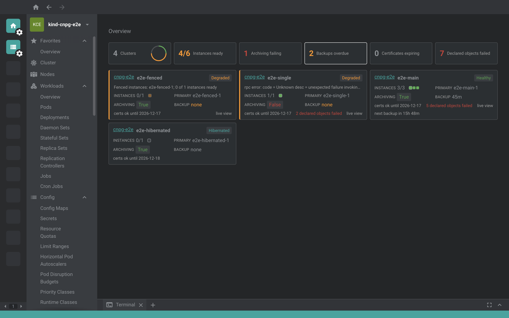
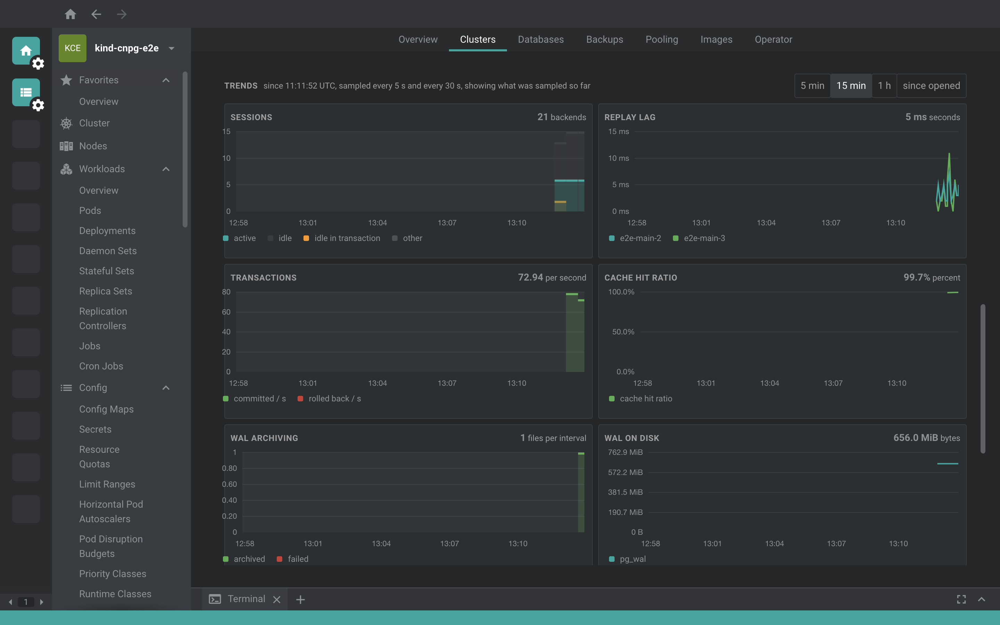
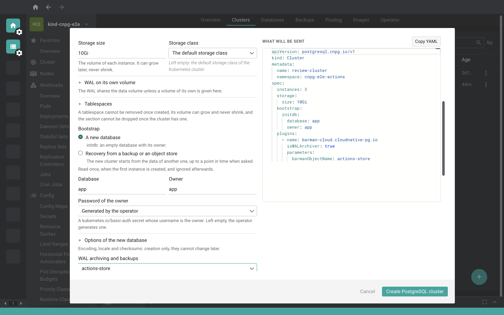

# @freelensapp/cnpg-extension

<!-- markdownlint-disable MD013 -->

[](https://freelens.app)
[](https://github.com/freelensapp/freelens-cnpg-extension)
[](https://deepwiki.com/freelensapp/freelens-cnpg-extension)
[](https://github.com/freelensapp/freelens-cnpg-extension/releases)
[](https://github.com/freelensapp/freelens-cnpg-extension/actions/workflows/unit-tests.yaml)
[](https://github.com/freelensapp/freelens-cnpg-extension/actions/workflows/integration-tests.yaml)
[](https://www.npmjs.com/package/@freelensapp/cnpg-extension)

<!-- markdownlint-enable MD013 -->

## Overview

[Freelens](https://freelens.app) extension for
[CloudNativePG](https://cloudnative-pg.io), the Kubernetes operator for
PostgreSQL: every PostgreSQL cluster the operator manages, from the Kubernetes
resources down to what happens inside the databases right now, inside the
Freelens desktop application and across every cluster it connects to.

The extension lives in the cluster sidebar under **CloudNativePG**:
**Overview**, **Clusters** (with the **Live View**, the **Logs** and the
**Timeline** of a cluster, and the **Failover Quorums**), **Databases**
(databases, roles, publications and subscriptions), **Backups** (backups,
scheduled backups and object stores), **Pooling**, **Images** and
**Operator**. Everything reads through the Freelens session that is already
authenticated to the Kubernetes cluster. The write actions (backups,
switchover, restart, reload, fencing, hibernation, the schedules, the
maintenance window, the destroy of a replica, the pause of a pooler) and the
creation forms write only after a dialog has listed the exact API calls, and
no database credential is ever read, stored or asked for.

[Video Demo](https://github.com/user-attachments/assets/fa708e56-a775-4bf7-827f-a1a8b461b9a1)







The goal is the most complete and usable graphical interface for
CloudNativePG. The extension is a from-scratch MIT implementation: it does
not reuse code or UI from any other CloudNativePG interface, graphical or
command line, which are functional references only. CloudNativePG is a
trademark of the Linux Foundation; this extension is not a CloudNativePG
product.

### Status

> **Version 2 for Freelens 2.** Every milestone of the roadmap is implemented
> and verified: M1 to M7 (the views, the live data, the write actions and the
> creation forms of 1.0.0), M8 (the port to the Freelens v2 extension API) and
> M9 (Connect and port forwarding, the server check of the forms, presets,
> recovery from an object store, the PostgreSQL configuration, the pooler
> pause, the maintenance window, the destroy of a replica, the diagnostic
> report, the operator's installation guide, Grafana links). The repository
> is developed spec-first: one spec per feature under
> [docs/specs](docs/specs/), each one verified by unit tests and by
> integration tests that drive this checkout in Freelens dev against a kind
> cluster with the real operator. See the
> [roadmap](docs/development/ROADMAP.md).

## Requirements

- **Freelens >= 2.0.0.** For Freelens 1.x, use a 1.x release of this
  extension.
- **A Kubernetes cluster with the CloudNativePG operator.** The reviewed
  operator version is 1.30.1, the API is `postgresql.cnpg.io/v1`. On a cluster
  without it, every page says so and shows what to install.
- **Optional:** the Barman Cloud plugin (reviewed at v0.15.1) for object
  stores, WAL archiving and backups through the plugin; the VolumeSnapshot
  CRDs and a CSI driver with snapshot support for backups taken as volume
  snapshots.
- **Kubernetes access** through the kubeconfig context Freelens uses for the
  cluster. The lists and drawers need `list` and `watch` on the
  CloudNativePG kinds; the Live View, the live figures of the poolers and
  the metrics of the operator need `get` on `pods/proxy`; the Logs need
  `get` on `pods/log`; Open psql and the PostgreSQL configuration need
  `create` on `pods/exec`; a local port needs `create` on
  `pods/portforward`; the copy buttons of the Connect section need `get` on
  the application user's Secret; every write action and form needs the verb
  it performs on the kind it touches (the server check of a form uses the
  same `create`), the switchover also `patch` on `clusters/status`, and the
  destroy of a replica `delete` on its volumes, its pod and its jobs. An
  action the account may not perform is disabled with the reason.
- **Node.js** is required only when building the extension from source; it
  is not needed to run it. The package is a self-contained bundle in
  `dist/`, so Freelens loads it without installing anything extra.

## Supported resources

Every kind below has its list and its drawer; the kinds a person creates by
hand have a creation form too, and the write actions are on the row menus and
in the drawers (see the [roadmap](docs/development/ROADMAP.md)).

### postgresql.cnpg.io/v1

<!-- markdownlint-disable MD013 -->

| Kind                  | Views                                                                                                                                                                                                                                                                                                                                                                                                                                                                                                        |
| --------------------- | ------------------------------------------------------------------------------------------------------------------------------------------------------------------------------------------------------------------------------------------------------------------------------------------------------------------------------------------------------------------------------------------------------------------------------------------------------------------------------------------------------------ |
| `Cluster`             | List with the health summary, drawer (instances, replication with the primary lease, PostgreSQL, declarative objects, storage with the tablespaces, backups and archiving, certificates, services and secrets, plugins), Overview, Live View with the trends, Logs, Timeline, creation form (image, storage, tablespaces, bootstrap from a new database, a backup, an object store or the volume snapshots of a backup, WAL archiving, volume snapshot backups, replication, resources, updates, scheduling) |
| `Backup`              | List and drawer with the restore coordinates and the volume snapshots                                                                                                                                                                                                                                                                                                                                                                                                                                        |
| `ScheduledBackup`     | List and drawer with the schedule in words and the backups it generated, creation form                                                                                                                                                                                                                                                                                                                                                                                                                       |
| `Pooler`              | List and drawer with the live PgBouncer figures, creation form, pause and resume                                                                                                                                                                                                                                                                                                                                                                                                                             |
| `Database`            | List and drawer with the managed objects and the size of the database right now, creation form                                                                                                                                                                                                                                                                                                                                                                                                               |
| `DatabaseRole`        | List and drawer with attributes, password and client certificate expiry, creation form                                                                                                                                                                                                                                                                                                                                                                                                                       |
| `Publication`         | List and drawer with the published objects, the replication path and the logical slots, creation form                                                                                                                                                                                                                                                                                                                                                                                                        |
| `Subscription`        | List and drawer with the replication path, the slot on the publisher and the failover caveat, creation form                                                                                                                                                                                                                                                                                                                                                                                                  |
| `ImageCatalog`        | List and drawer with the clusters that follow it, creation form                                                                                                                                                                                                                                                                                                                                                                                                                                              |
| `ClusterImageCatalog` | List and drawer with the clusters that follow it, creation form                                                                                                                                                                                                                                                                                                                                                                                                                                              |
| `FailoverQuorum`      | List and drawer with the failover check told in words                                                                                                                                                                                                                                                                                                                                                                                                                                                        |

### barmancloud.cnpg.io/v1

| Kind          | Views                                                                                                                                                                                                                          |
| ------------- | ------------------------------------------------------------------------------------------------------------------------------------------------------------------------------------------------------------------------------ |
| `ObjectStore` | List and drawer with the recovery windows (a cluster recovered from any of them in one click), creation form (Barman Cloud plugin; the in-tree `barmanObjectStore` form is deprecated and is never generated by the extension) |

<!-- markdownlint-enable MD013 -->

## Install

Open Freelens and go to Extensions (`ctrl`+`shift`+`E` or
`cmd`+`shift`+`E`). The field at the top takes a package name, the URL of a
tarball, or the path to a tarball or a directory.

### From the registry

Enter `@freelensapp/cnpg-extension` and press Install.

Alternatively, open the following URL in the browser to install directly:

[freelens://app/extensions/install/%40freelensapp%2Fcnpg-extension](freelens://app/extensions/install/%40freelensapp%2Fcnpg-extension)

### From a release tarball

Each [release](https://github.com/freelensapp/freelens-cnpg-extension/releases)
has the extension as `freelensapp-cnpg-extension-<version>.tgz`, with its
checksum in `freelensapp-cnpg-extension-<version>.tgz.sha256`. Use a release
whose major version matches your Freelens version.

- Enter the URL of the `.tgz` asset and press Install. Freelens downloads the
  `.tgz.sha256` next to it and checks the tarball against it.
- Or download both files into one directory and enter the path to the `.tgz`,
  or drop the `.tgz` on the Freelens window. Freelens checks it against the
  `.tgz.sha256` next to it.

### From a directory

Build the extension (see [Build from the source](#build-from-the-source)),
then enter the path to your checkout, the directory with `package.json`, and
press Install. Freelens runs the extension from that directory, from the
files in `dist/`, and lists it as unverified. This is how you work on the
extension: see [Development loop](#development-loop).

## Getting started

1. Connect to a Kubernetes cluster that runs the operator. A
   **CloudNativePG** group appears in the cluster's left sidebar. Pick the
   namespaces of your PostgreSQL clusters in the namespace filter, at the
   top of the Overview and of every list: on a first connection Freelens
   selects only `default`.
2. Open **Overview**: one tile per PostgreSQL cluster, ordered by urgency,
   with counters for the instances that are not ready, the archiving that
   fails, the backups that are overdue, the certificates that expire and the
   declared objects the databases do not have. Every figure leads to the
   list or the drawer behind it.
3. Open **Clusters** and a cluster: its drawer tells the whole story
   (instances and roles, replication, storage and tablespaces, backups and
   archiving, certificates, declared objects, plugins, the related pods,
   volumes, services and secrets). The row menu holds **Open psql**,
   **Back up now**, **Switchover**, **Restart**, **Reload**, **Fence**,
   **Hibernate** and **Open maintenance window**.
4. Open **Live View** and pick a cluster: replication topology and lag,
   sessions, database sizes, WAL and archiving, replication slots, and the
   trends since the page opened, read from the instances through the API
   server.
5. Press the **+** button of a list to create an object: the right pane of
   the form is the exact YAML the create sends.
6. No cluster at hand? `pnpm demo:up` builds one on your machine, see
   [Demo environment](#demo-environment-docker--kind).

> **Safety:** everything reads until you confirm a dialog that names the
> PostgreSQL cluster and the Kubernetes context and lists the exact API
> calls it makes. The extension runs no SQL of its own beyond fixed
> read-only queries on the instances, never stores a credential, and never
> generates a deprecated form of the operator's API. Open psql connects as
> the `postgres` superuser, see [Open psql](#open-psql).

## Features

### Overview and clusters

The **Overview** shows the health of every PostgreSQL cluster at a glance.
The **PostgreSQL Clusters** list carries a health summary (ready instances,
primary, WAL archiving, last successful backup); the drawer of a cluster
tells its whole story: instances and roles, replication with the primary
lease and the synchronous settings, storage with the tablespaces and their
state, certificates with their expiry, conditions, backups with the history
strip, the declared databases and roles, plugins, and the related pods,
volumes, services and secrets. **Failover Quorums** say, for clusters with
quorum based failover, whether a failover could be decided safely right now,
with the check told in words.

### Backups, archiving and object stores

**Backups** and **Scheduled Backups** with the outcome of every backup and
its reason, the coordinates needed to restore from it, the volume snapshots
it took, the schedule as written and in words, and a backup history strip
that shows at a glance how a cluster has been protected over time. **Object
Stores** of the Barman Cloud plugin: where backups and WAL go, which
clusters write there, and the recovery window the plugin itself reports for
each of them.

### Live View, Logs and Timeline

The **Live View** shows what happens inside a cluster right now (replication
topology and lag, sessions, database sizes, WAL and archiving, replication
slots) and nine trend cards drawn since the page opened (sessions by state,
replay lag per standby, transactions per second, cache hit ratio, WAL
archived and failed, WAL on disk, database sizes, checkpoints, deadlocks and
temporary files), read from the instances through the API server pod proxy
with nothing installed beyond the operator. The **Logs** page renders the
JSON lines of the instances as rows you can read (who said it, how serious
it is, the message, and for PostgreSQL the user, the database and the
query), every instance of a cluster on one time axis, followed live. The
**Timeline** puts the Kubernetes events of a cluster and of everything it
owns next to the facts that outlive them (backups, the change of primary,
the conditions) and to what is scheduled to come.

### Pooling, images and the operator

**Poolers**: every PgBouncer pooler, what it fronts, and in its drawer what
it is doing right now (clients, servers, clients waiting and for how long).
**Image Catalogs** and **Cluster Image Catalogs**: what each catalog offers
per major version and which clusters follow it, with the image each cluster
runs next to the image the catalog offers. **Operator**: version, replicas,
who leads, what it watches, its configuration, the reconciles per controller
right now from its own metrics, the CNPG-I plugins it found with the clusters
that loaded them, and the kinds the cluster serves.

### Declarative databases and logical replication

**Databases**: every database declared for a cluster and whether PostgreSQL
has it as declared; when it has not, which part failed and why, down to the
single extension or schema, and in the drawer the size and the sessions of
the database right now. **Database Roles**: what each role may do, how it
authenticates and until when (password expiry, client certificate expiry),
and the role of the cluster spec that wins over it when both declare the
same name; secrets are linked, never read. **Publications** and
**Subscriptions**: a logical replication read as one path, from the
publication of one cluster to the subscription of another, with the
replication slot on the publisher right now and whether the pair survives a
failover of the publisher.

### Write actions

Every action is behind a dialog that names the cluster and the Kubernetes
context, lists the exact API calls, says what happens in order and what it
costs, and is disabled with the reason where it makes no sense or where the
account may not perform it.

- **Back up now**, with the method the cluster really has (plugin or volume
  snapshot; the deprecated in-tree method is never preselected), the
  instance it will be taken from and what is ahead of it in the queue.
- **Switchover** to the standby you choose from a table of the standbys as
  they are right now (which ones can be promoted and why the others cannot,
  the sync state, the replay lag read from the primary every five seconds),
  with the name of the cluster typed to confirm; **Promote** on the row of
  a standby opens the same dialog with that standby chosen.
- **Restart** of a cluster, with the rollout in order from the cluster's own
  settings, or of one instance from its row; **Reload**, told honestly.
- **Fencing** of one instance or of all of them, with the old and the new
  value of the annotation spelled out and the warnings about the primary and
  the synchronous replication; the fence is lifted from the same rows.
- **Hibernate** and **Resume**, with everything attached to the cluster and
  what happens to it listed before the click.
- **Suspend**, **Resume** and **Run now** on a scheduled backup, with what
  the operator will do next said in the dialog.
- **Open maintenance window** and **Close maintenance window** of the nodes
  of a cluster, with what the operator does with an instance on a drained
  node for the choice about its volumes; the Overview and the drawer say
  while it is open.
- **Destroy** on the row of a replica (never the primary), with the name
  typed to confirm and the writes of `kubectl cnpg destroy` listed in their
  order: its volumes, its pod, its jobs; the operator then recreates the
  instance from the primary.
- **Pause** and **Resume** of a pooler, with the clients connected through
  it right now.

### Creation forms

A PostgreSQL cluster, a scheduled backup, a pooler, an object store, a
database, a role, a publication, a subscription and an image catalog (of a
namespace or of the whole Kubernetes cluster), from the **+** button of
their lists and from the drawer of a cluster. The form is the confirmation:
its right pane is the exact YAML the create sends, every rule of the
operator's admission the form can express is checked at the field, the
recommended shape is the default (backups through the Barman Cloud plugin,
no deprecated field), the values the operator stamps on its own are shown and
never sent, and the OK button says why it is disabled until the form is
complete. Once the form is complete, the API server checks the YAML with a
dry run (the operator's webhooks included, nothing created) and its answer
shows under the YAML, a refusal naming the field. The cluster form covers the image, the storage, the tablespaces,
the bootstrap (a new database, a completed backup, an object store, or the
volume snapshots of a backup with the optional WAL archive of the source),
WAL archiving, backups as volume snapshots (hot or cold), replication,
resources, updates and scheduling, with presets of PostgreSQL parameters
sized on the memory of the instances and on the WAL disk. "Recover" on a
server of an object store's recovery windows opens it filled for a recovery
of that server. The scheduled backup form has a cron
editor with the next three runs; the declarative forms say the SQL the
primary will run.

### Connect and forward a local port

The drawer of a cluster (and of a pooler) has a **Connect** section: each
service with its in-cluster host and port and what it is for (rw, ro, r and
those of `spec.managed.services`), the application database and user, and
buttons that copy the password, the URI or the JDBC URI of its Secret. The
Secret is read when the button is pressed and its value goes to the
clipboard only. **Forward a local port** runs `kubectl port-forward --address
127.0.0.1 service/<name> :5432` in the Freelens main process with the
kubectl and the connection of the cluster; the drawer lists the forwards
with their local address, "Copy psql command" (no password in it) and
"Stop". A forward ends when it is stopped, when the cluster disconnects, when
the extension is disabled and when Freelens quits. It needs `create` on
`pods/portforward`.

### PostgreSQL configuration

**Configuration**, from the sidebar, the menu or the drawer of a cluster,
shows the parameters and the HBA rules the primary runs with, as `kubectl
cnpg status -v -v` prints them (`custom.conf` and `pg_hba.conf`, read with
two fixed `cat` commands through `kubectl exec`, which needs `pods/exec`),
where each parameter comes from, a value of the spec not applied yet, and
for each instance whether a restart is pending.

### Diagnostic report

**Save diagnostic report**, in the menu of a cluster, saves one ZIP file
where you choose, for an issue or a support case, after `kubectl cnpg report
cluster`: the cluster and its pods, jobs, volumes, services and disruption
budgets, its backups, schedules, poolers, declarative objects, failover
quorum and object stores, the events about them, the status of each
instance and, if you ask, the last lines of their logs. It reads only; no
Secret is read, `managedFields` are removed and values under keys named like
a password, a token or a key are replaced. A `README.txt` in the archive says
what is in it and what could not be read.

### Open psql

"Open psql" writes one command into a terminal tab of Freelens, the same one
the `kubectl cnpg psql` plugin runs:
`kubectl exec -i -t -n <namespace> <pod> -c postgres -- psql -U postgres`.
It runs under your own kubeconfig, needs `kubectl` on the PATH of the
Freelens terminal and `pods/exec` on the instance pod. **The session
connects as the `postgres` superuser** over the local socket of the
instance, exactly as the upstream plugin does; on a standby it is a
read-only session. The extension itself never runs SQL in that session and
never sees a credential: it composes the command from the namespace and the
pod name, and everything after that happens in your terminal.

## Limits

- The Live View, the live figures of the poolers and the metrics of the
  operator are read through the API server pod proxy: without `get` on
  `pods/proxy` the panel says what to grant, and a cluster whose instances
  do not answer shows what the resources say and nothing more.
- Backups as volume snapshots need the VolumeSnapshot CRDs and a CSI driver
  with snapshot support in the Kubernetes cluster; a hot snapshot is
  recovered with the WAL archive of the source; the form offers recovery
  from volume snapshots, not from a bare persistent volume claim.
- The forms create; editing an existing object is the host's own YAML
  editor in the drawer. Bootstrap by streaming from another cluster
  (`pg_basebackup`), the import of databases and the fields an operator
  sets in YAML once and for all are outside the form: the YAML pane can be
  copied to finish the job by hand.
- The deprecated in-tree `barmanObjectStore` backup method is shown where it
  exists, with a badge, and never generated.
- The suites run on macOS locally and on Linux in CI; Open psql on Windows
  depends on `kubectl` being on the PATH of the Freelens terminal.

## Development

The repository is developed spec-first, with the specs in the repository:

- [PROCESS.md](docs/development/PROCESS.md): the spec-driven workflow, the
  manual verification escalation and the milestone review gate.
- [ROADMAP.md](docs/development/ROADMAP.md): scope and progress.
- [ARCHITECTURE.md](docs/development/ARCHITECTURE.md): renderer and main
  process roles, the data paths to the cluster, the licensing boundary.
- [DESIGN.md](docs/development/DESIGN.md): the binding UI directives.
- [TESTING.md](docs/development/TESTING.md): the test layers and how to run
  them.
- [TRY-IT.md](docs/development/TRY-IT.md): the demo cluster and a guided
  walk through every view.
- [docs/specs](docs/specs/): one spec per feature, SPEC-0001 being the
  recon digest every other spec builds on.

### Local gates

The Node.js version of `.nvmrc` (also in `mise.toml`) and `corepack pnpm`.
Run the local gates after every change:

```sh
pnpm type:check
pnpm lint:check     # biome (lint:fix to auto-format)
pnpm build
pnpm knip:check
pnpm test:unit
pnpm trunk:check    # the formats Biome does not cover
```

### Demo environment (Docker + kind)

`demo:up` builds a disposable, fully populated environment on your machine,
so that anyone can try the extension or record a demo without preparing
anything by hand. It needs Docker (about 8 GB of memory for its VM), `kind`,
`kubectl` and Node.js.

```sh
pnpm demo:up      # about ten minutes the first time, seconds afterwards
pnpm demo:down    # deletes the demo cluster and its state folder
```

What you get: a dedicated kind cluster `cnpg-demo` (kubeconfig printed at
the end, never written into your own), the CloudNativePG operator 1.30 with
the Barman Cloud plugin, an in-cluster object store, a CSI driver with
snapshot support, four PostgreSQL clusters in different states (healthy with
a running load, degraded with a failing archive, hibernated, fenced), one
more cluster for the write actions and one on the snapshot storage class,
real backups, schedules, a pooler, and declared databases, roles,
publications and subscriptions, some of them failing on purpose. The
[walkthrough](docs/development/TRY-IT.md) then takes you through every view.

### Integration tests and pre-review pass

The integration tests drive this checkout, installed in place in Freelens
dev, against a kind cluster with the real operator; the pre-review pass walks
every view on both themes, checks the rules of DESIGN.md a machine can
check, and leaves the screenshots and a report under `e2e-artifacts/`. Both
need a Freelens checkout next to this one, see
[TESTING.md](docs/development/TESTING.md).

```sh
pnpm e2e:cluster:up
pnpm e2e:freelens        # in another terminal: Freelens dev on the cluster
pnpm build
pnpm test:integration
pnpm e2e:cluster:down
```

The writes go to the namespace `cnpg-e2e-actions` of the cluster the script
created, never to another cluster. The cases of the Connect section and of
the diagnostic report also need `psql`, `pg_isready` and `python3` on the
`PATH`. Without Freelens dev or the cluster the tests are skipped.

Optional variables:

- `E2E_CLUSTER_NAME`: the kind cluster, `cnpg-e2e` by default, used through
  the context `kind-<name>`; `cnpg-bare` runs `cnpg-bare.tests.ts` on the
  cluster of `pnpm e2e:bare:up`, which has no CloudNativePG.
- `FREELENS_CDP_URL`: the CDP endpoint of Freelens dev,
  `http://127.0.0.1:9223` by default.
- `FREELENS_MAIN_LOG`: a log of the main process to check for errors. Without
  it only the renderer's errors are checked.
- `FREELENS_MAIN_INSPECT`: the inspector port of the main process of
  Freelens dev, `5858` by default, through which the case of the diagnostic
  report answers the save dialog.
- `E2E_ARTIFACTS_DIR`: where the screenshots go, `e2e-artifacts/` by default.

The pre-review pass (`pnpm pre-review`) runs on the demo cluster, with Freelens
dev started on it as TESTING.md describes.

## Build from the source

### Prerequisites

Use [NVM](https://github.com/nvm-sh/nvm),
[mise-en-place](https://mise.jdx.dev/), or
[windows-nvm](https://github.com/coreybutler/nvm-windows) to install the
Node.js version in `.nvmrc`.

From the root of this repository:

```sh
nvm install
# or
mise install
# or
winget install CoreyButler.NVMforWindows
nvm install "$(cat .nvmrc)"
nvm use "$(cat .nvmrc)"
```

Install pnpm:

```sh
corepack install
# or
curl -fsSL https://get.pnpm.io/install.sh | sh -
# or
winget install pnpm.pnpm
```

### Build extension

```sh
pnpm install
pnpm build
```

The extension is built into `dist/`. To pack it into a tarball:

```sh
pnpm pack
```

One script to bump the prerelease version, build and pack the extension for
testing:

```sh
pnpm pack:dev
```

The tarball is placed in the current directory. Install it as described in
[From a release tarball](#from-a-release-tarball).

### Development loop

Install the extension from your checkout once, as described in
[From a directory](#from-a-directory), then run:

```sh
pnpm dev
```

It rebuilds the extension whenever a source file changes, and Freelens
reloads the extension after each rebuild, the main process included, without
a restart and without packing. Stop it with `ctrl`+`C`.

Neither `pnpm build` nor `pnpm dev` type-checks; run `pnpm type:check` for
that. A change to `main` or `renderer` in `package.json` needs Freelens
restarted once.

To check the extension in Freelens with an AI agent, see "Checking the
Extension in Freelens Dev" in the
[template's AGENTS.md](https://github.com/freelensapp/freelens-example-extension/blob/main/AGENTS.md).

### Check the code

```sh
pnpm type:check
pnpm test:unit
pnpm lint:check
pnpm knip:check
```

and, for the formats that Biome does not cover:

```sh
pnpm trunk:check
```

### Testing the extension with unpublished Freelens

In the Freelens working repository:

```sh
rm -f *.tgz
pnpm i
pnpm build
pnpm pack -r
```

Then in the extension repository:

```sh
echo "overrides:" >> pnpm-workspace.yaml
for i in ../freelens/*.tgz; do
  name=$(tar zxOf $i package/package.json | yq -r .name)
  echo "  \"$name\": $i" >> pnpm-workspace.yaml
done

pnpm clean:node_modules
pnpm build
```

## License

Copyright (c) 2025-2026 Freelens Authors.

[MIT License](https://opensource.org/licenses/MIT)
